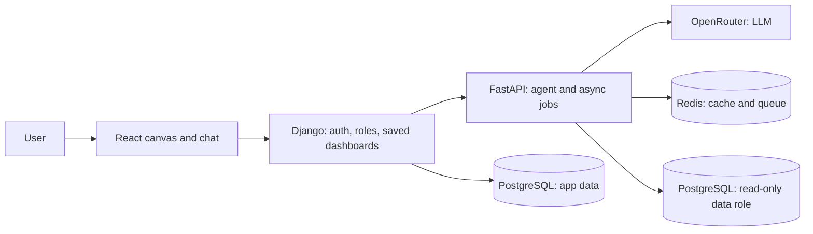

# RoleCanvas
 
**A role-aware dashboard agent. Pick a role, describe what you want to see, and an LLM agent builds the charts on a live canvas from open datasets.**
 


 
> **Status: Phase 0 (project scaffolding).** Everything under "Planned features" is a design target, not a finished feature. This README is updated as each phase ships.
 
## Why this exists
 
Most "chat with your data" demos return a text answer or a one-off chart. Business users need something different: charts that match their role, use their metric definitions, and can be trusted. RoleCanvas explores that with three ideas:
 
1. **The role is a semantic layer, not a prompt label.** Each role has its own metric definitions, default KPIs, allowed tables and columns, and chart conventions.
2. **The LLM never runs code.** It produces a validated JSON chart specification and calls a fixed set of query tools.
3. **Quality is measured.** A per-role evaluation set scores spec validity, query correctness, numeric faithfulness, correct refusals, cost and latency.
## Planned features
 
- Google sign-in and role selection by department (the four demo roles Marketing, Finance, Operations and Executive, plus more). Sign-in, first-time onboarding and a profile page exist; see "Frontend (in development)"
- Chat panel that turns a prompt into one or more charts on a draggable canvas
- Role-specific metric catalog and chart defaults
- Refusal when a role asks for data it is not allowed to see
- Saved dashboards per user
- Evaluation harness with a published results table and failure analysis
## Architecture
 

 
### How a prompt becomes a chart
 
1. The user sends a prompt with their role attached.
2. The agent loads that role's metric catalog and allowed schema.
3. The LLM selects from fixed tools (list metrics, run a parameterized query, aggregate) and returns a chart spec.
4. The backend validates the spec against a JSON schema and checks the numbers against the query result.
5. The React canvas renders the validated spec.
## Access model (backend in development)

Admins create departments and roles in the Django admin and decide, per role, which datasets, columns and rows are visible (and whether results must be aggregated). Users sign in with Google, then pick a department and a role inside it. The agent will only ever see the access resolved for that user. See [docs/roles-and-access.md](docs/roles-and-access.md) for the model, the API, the seeded roles and the access rules. Enforcement inside the agent is planned.

## Frontend (in development)

React + TypeScript (Vite) with four screens: **login** (Google button), **onboarding** (a first-time user picks a department, then a role inside it), **dashboard** (a placeholder canvas and the list of datasets your role can and cannot access) and **profile** (change department, role and region at any time). The chart canvas and prompt box are present but disabled until the agent exists (planned). The browser talks only to the Django backend. The short-lived access token is kept in memory and the refresh token in `localStorage`, a demo-level trade-off to revisit before production.

To sign in you need a Google OAuth client ID in `GOOGLE_OAUTH_CLIENT_ID`; see "Setting up Google sign-in" in [docs/roles-and-access.md](docs/roles-and-access.md). The frontend reads the same variable.

## Tech stack
 
| Layer | Choice |
|---|---|
| Frontend | React |
| Auth and app API | Django |
| Agent and async jobs | FastAPI |
| Database | PostgreSQL |
| Cache and queue | Redis |
| LLM access | OpenRouter |
| Deployment | Docker Compose on a VPS |
 
## Security by design
 
- Read-only database role for all agent queries, with row limits and statement timeouts
- Parameterized, allow-listed query tools only
- The LLM output is data to validate, never code to execute
- Dataset contents are treated as data, never as instructions
- Postgres and Redis are not exposed to the internet, and traffic goes through an HTTPS reverse proxy
- Per-user rate limits, response caching and a spending cap on the LLM key
- Secrets live in `.env`, which is git-ignored. Only `.env.example` is committed
## Evaluation
 
Each role has a test set of prompts with known-good answers.
 
| Metric | What it checks |
|---|---|
| Spec validity | Output matches the chart schema |
| Query correctness | Result matches a reference SQL query |
| Numeric faithfulness | Every number on the chart appears in the query result |
| Refusal accuracy | Disallowed requests are refused, allowed ones are not |
| Cost and latency | Tokens and seconds per prompt, by model |
 
Results, with confidence intervals and a failure taxonomy, will be published in `docs/evaluation.md`.
 
## Quickstart

Requires Docker (with Compose v2). Python and Node are only needed for local development outside Docker.

```bash
git clone https://github.com/<your-username>/rolecanvas.git
cd rolecanvas
cp .env.example .env      # then edit .env: set OPENROUTER_API_KEY and replace the change-me values
docker compose up --build
```

Then load the demo roles and data, and create an admin user for the Django admin:

```bash
make setup            # once, if you have not already (needs Python 3.12, Poetry 2.x, Node LTS)
make seed             # demo departments, roles, datasets, grants and synthetic demo tables
make superuser        # email + password for http://localhost:8000/admin/
```

Then check:

- Django admin: `http://localhost:8000/admin/`
- Frontend (sign-in page): `http://localhost:3000`
- Backend health: `http://localhost:8000/health/`
- Agent health (also checks Redis and Postgres): `http://localhost:8001/health`

Postgres and Redis publish no ports in `docker-compose.yml`. The committed `docker-compose.override.yml` is loaded automatically and publishes them on `127.0.0.1` only (Postgres on 5433, Redis on 6380) for local debugging. To start without it, run `docker compose -f docker-compose.yml up --build`.

## Local development

Versions are pinned: Python 3.12, Poetry 2.x, Node from `.nvmrc`. See `docs/versions.md`. A Makefile wraps the common tasks and detects your OS (macOS, Linux, or Windows from Git Bash or WSL). Run `make help` for the full list.

```bash
make setup        # check prerequisites, create .env (with a generated Django secret), install everything
make dev          # all services in Docker
make dev-local    # Postgres and Redis in Docker; backend, agent and frontend run natively with reload
```

| Command | What it does |
|---|---|
| `make setup` | Prerequisite check, `.env`, Poetry installs into `backend/.venv` and `agent/.venv`, `npm ci`, pre-commit hooks |
| `make dev` / `make up` | All five services in Docker (foreground / background) |
| `make db`, `make redis` | Start only Postgres or only Redis |
| `make dev-backend`, `make dev-agent`, `make dev-frontend` | One native process with reload (start `make db redis` first) |
| `make seed` | Migrate, then load demo departments, roles, datasets, grants and synthetic tables (safe to repeat) |
| `make superuser` | Create a Django admin user for `/admin/` |
| `make manage CMD="..."` | Run any `manage.py` command against the Docker database |
| `make dev-token EMAIL=...` | Dev-only JWT without Google (needs `DJANGO_DEBUG=True`) |
| `make db-shell`, `make redis-cli` | Open `psql` or `redis-cli` in the container |
| `make down`, `make logs`, `make ps` | Stop, follow logs, show status |
| `make db-reset` | Delete the local database volume (asks first) |
| `make check` | Run what CI runs: ruff, mypy, pytest, frontend tests and build. Backend tests use in-memory SQLite and need no database. |

`make dev-local` stops the Docker app containers first so ports 8000, 8001 and 3000 are free. Native processes reach Postgres on `127.0.0.1:5433` and Redis on `127.0.0.1:6380`, which come from `docker-compose.override.yml`.

Without Make, the equivalent manual steps are:

```bash
poetry config virtualenvs.in-project true   # one-time: create .venv inside each Python project
cd backend && poetry install && poetry run pytest
cd ../agent && poetry install && poetry run pytest
cd ../frontend && nvm use && npm ci && npm test && npm run build
```

## Secrets and configuration

All configuration is read from environment variables. The real values live in `.env`, which is git-ignored; only `.env.example` is committed. Never put keys in code, settings files, Dockerfiles or `docker-compose.yml`.

Beyond the OpenRouter key and Django secret, `.env` holds `JWT_SIGNING_KEY` (token signing, separate from the Django key), `GOOGLE_OAUTH_CLIENT_ID` (Google sign-in; see the setup steps in `docs/roles-and-access.md`), and optional `ALLOWED_EMAIL_DOMAINS` and `CORS_ALLOWED_ORIGINS`. Avoid `$` and `#` in values, which break `make` and shell parsing.

For GitHub Actions, add two repository secrets under Settings, Secrets and variables, Actions: `OPENROUTER_API_KEY` and `DJANGO_SECRET_KEY`. The `compose-smoke` CI job uses them to build and start the stack; it generates its own `JWT_SIGNING_KEY` for each run.

Install the pre-commit hooks (ruff and the gitleaks secret scanner) once per clone:

```bash
pip install pre-commit    # or: brew install pre-commit
pre-commit install
```

## Troubleshooting

**Backend or agent unhealthy with `password authentication failed`.** Postgres reads `POSTGRES_PASSWORD` and `POSTGRES_READONLY_PASSWORD` only the first time it initialises an empty volume. If you change either value in `.env` afterwards, the database keeps the old one. Fix it with either:

- `make db-reset` to delete the local database volume and recreate the roles from `.env` (local data is lost; it asks first), or
- keep the data and change the passwords in place: `make db-shell`, then `ALTER ROLE <user> PASSWORD '<new value>';` for the owner and read-only roles.

**Upgrading from the Phase 0 scaffold.** The `datasets` schema, the stricter read-only role and the custom user model are created or required from the first database initialisation. If you have an older local database, run `make db-reset`, then `make up` and `make seed`.

## Repository layout

```
rolecanvas/
  backend/        Django project: Google/JWT auth, departments, roles, data catalog and grants (apps: accounts, catalog)
  agent/          FastAPI service: tools, chart-spec validation, jobs
  frontend/       React app: Google login, onboarding, dashboard and profile (canvas and chat planned)
  eval/           Test sets, scoring scripts, results
  data/           Dataset download scripts (no raw data committed)
  docs/           Architecture, role definitions, evaluation report, versions
  infra/          Postgres init script (owner and read-only roles)
  scripts/        Helper scripts used by the Makefile
  make/           Makefile fragments (OS detection, setup, dev, quality)
  Makefile
  docker-compose.yml
  .env.example
```

## Roadmap
 
- [x] **Phase 0:** Project scaffold: repo layout, Poetry projects, Docker Compose, health checks, CI
- [ ] **Phase 1:** FastAPI agent, one public dataset, one role, prompt to chart spec to rendered chart, evaluation harness v0, local Docker Compose
- [ ] **Phase 2:** Django auth and roles, React canvas, Redis cache and job queue
- [ ] **Phase 3:** VPS deployment, HTTPS, CI, tracing and cost tracking
- [ ] **Phase 4:** Evaluation report, failure analysis, write-up
## Datasets
 
Datasets are public and downloaded by script. Each dataset's license and source are listed in `data/README.md`. No personal data is used.
 
## Limitations
 
- Generated charts can still be wrong. Always check the underlying query shown with each chart.
- The role model is a demo of access control, not a production authorization system.
- Free and low-cost LLM tiers have rate limits that change over time.
## License
 
MIT. See `LICENSE`.
 
## Author
 
Souvik Samanta
 